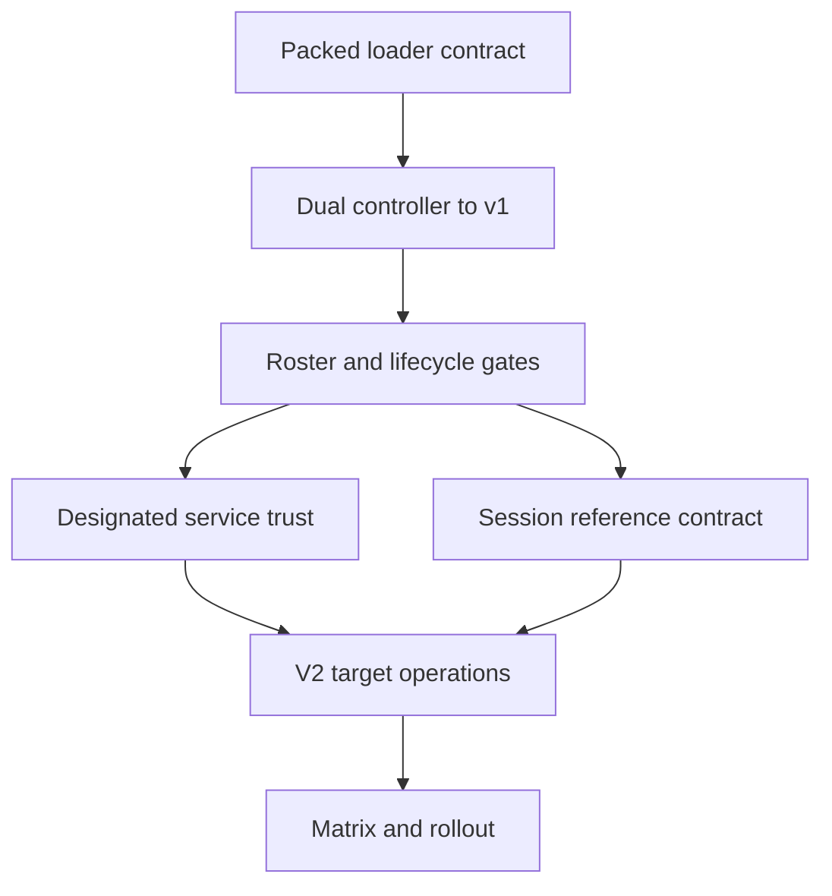

---

title: "feat: Support OpenCode v1 and v2 from one Space Bus package"
type: feat
status: active
date: 2026-11-25
deepened: 2026-11-25
origin: docs/brainstorms/2026-11-25-opencode-v2-coexistence-requirements.md
---

# OpenCode coexistence: dual controllers, shared v2 targets

## Overview

Move the controller first. Install one tarball in either OpenCode generation; let a v2 controller and the MCP connector select either kind of roster. For v2 targets, Space Bus is a guest of a designated, independently running local service, never its supervisor.

| Caller    | v1 target                                             | v2 target                                         |
| --------- | ----------------------------------------------------- | ------------------------------------------------- |
| v1 plugin | Preserve current managed and external modes           | Refuse before discovery, spawn or delegation      |
| v2 plugin | Same behavior as v1 plugin                            | Read-only discovery; delegate to selected project |
| MCP       | Preserve active-roster precedence and v1 spawn opt-in | Same designated service as plugin; never spawn    |

## Problem frame

A plugin that loads but sends a prompt to the wrong directory is worse than an unsupported plugin. Package loading, target selection, and session ownership need independent proofs. Existing v1 lookup trusts the session directory returned by the selected host; that cannot distinguish two services with the same session ID and project directory.

## Requirements trace

- R1: One packed artifact, six tools, two native controller adapters; retain reserved `./server` and separate `./managed-server` (U1, U2, U7).
- R2: Unchanged v1 rosters and lifecycle semantics; MCP attach-only by default (U2, U3, U7).
- R3: One generation per roster, resolved per call, independently of the controller generation (U2, U3, U6).
- R4: The same designation resolves from distinct environments and across service port changes (U3, U4, U6, U7).
- R5: Refuse unavailable, unsafe or wrong-generation targets without disclosing credentials, falling back or managing the service (U3, U4, U7).
- R6: Preserve six-tool behavior, location ownership, cross-surface parity and browser isolation (U2, U5–U7).
- R7: v1 controller refuses a v2 roster without creating work or a host (U3, U7).
- R8: Operator drains outstanding and blocked work; reject stale or unassociated references before acting on unrelated sessions (U5–U7).

## Scope boundaries

Tools first. Preserve v1 library behavior; v2 library-only operations without verified support return explicit unsupported errors, not empty success. No cross-host wait, automatic session transfer, seventh tool, mixed targets within one roster, remote hosts, or lowering the v1 floor without an operator decision.

### Deferred to separate tasks

Space Bus-owned v2 service creation, persistence, supervision and stop belong to milestone 2. Full v2 parity for library-only history, snapshot, question and diff consumers is not a prerequisite for this release. Do not defer behavior the six tools themselves need, such as answering a blocked question or obtaining the correct task result.

## Context & research

- `src/index.ts`, `src/tools/` and `src/mcp.ts`: v1 adapters import the v1 SDK at runtime. MCP shares descriptions but declares input schemas separately. Simply making the peer optional does not make these imports optional.
- `src/config.ts`, `src/roster-edit.ts`, `src/tools/shared.ts`: manifest parsing and writes, selection, and the pre-load spawn decision are separate boundaries. Do not add a generation field that old parsers can ignore and then treat as v1.
- `src/core.ts`: v1 response normalization, message correlation, question handling and per-directory routing are established behavior. `findSessionDirectory` checks roster membership, not service provenance.
- The plugin conversion is recorded as completed in `docs/plans/2026-07-02-001-feat-space-bus-plugin-conversion-plan.md`; it did not verify two real loaders. `docs/solutions/integration-issues/opencode-plugin-reserved-subpath-loader-resolution-2026-07-11.md` explains why source-path dogfooding missed an npm loader regression.
- Planning baseline: main `118385f` (tree `c51bd6d`). The requirements accompany this plan. Host characterization results below were obtained during U1, not during planning.

## Prior-Art Survey

```json
{
  "schema_version": 2,
  "verdict": "extend",
  "scope": "fro-bot/space-bus single-package repository: src, package.json, loader and multi-roster planning records; bounded survey, not an exhaustive dependency audit",
  "freshness": {
    "vcs_reference": "118385f168cef0a2e8a9169a5683da329a8c469b",
    "scope_baseline": "tree c51bd6d9bbd20dfaa2f5b67d154eac8f39a1482d"
  },
  "budget": {
    "max_search_passes": 4,
    "max_candidate_inspections": 12,
    "exhausted": false
  },
  "candidates": [
    {
      "path_or_symbol": "package.json",
      "description": "Reserved plugin entry, distinct lifecycle exports and peer range",
      "disposition": "extend"
    },
    {
      "path_or_symbol": "src/index.ts",
      "description": "Controller adapter and six-tool registration",
      "disposition": "extend"
    },
    {
      "path_or_symbol": "src/config.ts",
      "description": "Manifest and per-roster context loading",
      "disposition": "extend"
    },
    {
      "path_or_symbol": "src/mcp.ts",
      "description": "MCP selection and session-local roster precedence",
      "disposition": "extend"
    },
    {
      "path_or_symbol": "src/contract.ts",
      "description": "Browser-safe target and discovery validation",
      "disposition": "extend"
    },
    {
      "path_or_symbol": "validateContext",
      "description": "Per-call validation on a copy before request I/O",
      "disposition": "reuse"
    },
    {
      "path_or_symbol": "findSessionDirectory",
      "description": "v1 session ownership and project lookup",
      "disposition": "extend"
    },
    {
      "path_or_symbol": "src/discovery.ts",
      "description": "v1 managed discovery; retain as separate from externally owned registration",
      "disposition": "reuse"
    },
    {
      "path_or_symbol": "src/server.ts",
      "description": "Managed lifecycle must exclude shared targets",
      "disposition": "extend"
    }
  ]
}
```

## Key technical decisions

| Decision                                                                                                                                                                        | Why / rejected alternative                                                                                                                                                                                                                                                                                                                                                                                                                                                                                            |
| ------------------------------------------------------------------------------------------------------------------------------------------------------------------------------- | --------------------------------------------------------------------------------------------------------------------------------------------------------------------------------------------------------------------------------------------------------------------------------------------------------------------------------------------------------------------------------------------------------------------------------------------------------------------------------------------------------------------- |
| Separate controller adapter from target protocol.                                                                                                                               | A v2 controller must run against v1 before v2 service discovery works. Never infer target generation from the loading SDK.                                                                                                                                                                                                                                                                                                                                                                                            |
| Retain one default entry with native v1 and v2 adapters, subject to the real-loader gate.                                                                                       | [Systematic](https://github.com/marcusrbrown/systematic/blob/bb8daab3e1232b663a6efaaed4c669e62446d5ae/docs/plans/2026-10-27-001-feat-opencode-v2-support-plan.md) and [Copilot Delegate](https://github.com/marcusrbrown/opencode-copilot-delegate/blob/b8f05d1048cbe688fcb26d53396d57e581c508a0/docs/plans/2026-11-20-002-feat-opencode-v2-dual-host-plan.md) provide precedents, not proof at our floor. Prefer the object with separate setup/server entry points; do not assume a decorated function is accepted. |
| Add a mutually exclusive shared-v2 roster variant identifying a registration by explicit absolute file location.                                                                | A stable designation is not an endpoint, secret, or claim of ownership. No ambient profile, port scanning, default service or CLI `ensure` fallback. Keep registry metadata operations offline.                                                                                                                                                                                                                                                                                                                       |
| Resolve the designation once per tool call. Validate one registration snapshot for each connection; do not combine credentials from one snapshot with an endpoint from another. | In [v2.3.2 discovery](https://github.com/anomalyco/opencode/blob/c0ad18b402eb2827fc1ee71c171b1177b3fc02d1/packages/client/src/service-probe.ts#L48-L97), the password is sent before PID/version confirmation. A reconnected wait must refuse a changed instance rather than silently retarget.                                                                                                                                                                                                                       |
| Keep bare IDs for v1 only. Expose a reusable, non-secret Space Bus reference for v2 sessions.                                                                                   | A new v2 operation must not reinterpret a bare v1 ID, a caller-provided project name, or a prompt correlation ID as proof of origin. Require fresh references across restarts unless history continuity is verified.                                                                                                                                                                                                                                                                                                  |

## Implementation units

### U1 evidence recovered on 2026-11-26

The 15-cell macOS arm64 run's console summary and per-cell report extract survived; its tarballs and full JSON did not. Baseline: `118385f`, package `0.16.0`. The same packed object candidate (SHA-256 `e94b1287ffe7fede13f70e215b394360660644ff6c8b8c659cb4b859fe39189b`) loaded in real v1.17.13, v1.19.6 and v2.3.2 hosts. The v2 observer saw all six tool names. Keep the existing v1 floor as the target; use the object default with `id`, `server`, and `setup` for adapter development.

The baseline loaded on both v1 hosts. On v2 it failed without the v1 peer, and still failed on the function export when that peer was supplied. A decorated function passed a manual setup call but was rejected by the real v2 loader. This was the one unexpected candidate outcome (matrix exit 2); the no-plugin and v1 broken-subpath controls behaved as expected. These were installed tarballs referenced locally by the hosts, not a live registry publication test. No bus tool executed. Six names and object-shaped inputs do not establish argument fidelity, duplicate handling, or successful delegation. The later extended run was interrupted and cannot establish the outstanding v2 duplicate-reference/subpath cases.

Listener feasibility is independently verified on macOS (35/35) and [Ubuntu 24.04](https://github.com/fro-bot/space-bus/actions/runs/45892684416) (34/34); fixture and manual CI job landed in [#295](https://github.com/fro-bot/space-bus/pull/295). These counts are not loader checks.

**Focused U1 exit:** local evidence `.context/u1-loader/u1-fidelity-20261126T213219Z-c87b65/summary.json` (ignored): 15 cells, exit 0. The object candidate exposed matching normalized JSON Schemas for six tools on all three macOS arm64 hosts; each detected a deliberately removed required `bus_task.prompt`. Preserve field descriptions by converting with the schema-owning Zod instance. Duplicate configuration did not double-register tools; on v2 the second plugin entry visibly failed with a duplicate ID, while the first remained active. One setup and three transform evaluations occurred in both single and duplicate configurations: keep repeatable registration separate from one-time setup. No handler ran. The v2 candidate embeds reference schemas, so U2 must independently verify the native adapter, runtime-only validation rules, and actual v1-target delegation. U1 characterization is complete; its loader harness is local, not shipped.

**Retained reproduction:** on macOS arm64, run `bun run scripts/verify-host-matrix.ts`. The trimmed harness passed nine cells at base `395d383`: single reference, duplicate reference, and a deliberately changed required argument on each of the three hosts. Candidate tarball SHA-256: `e285388301ab394307edb7dbe0791e23974e109558c556b5998cf7f662ea4620`. This replaces the exploratory harness for repeat runs. New evidence is written under `.context/u1-loader/` and stays out of Git. These fixtures do not ship in the plugin or exercise task delegation.



- [x] **U1. Characterize the package and supported hosts** (R1, R2; AE1)

  **Files:** `package.json`, `build.ts`, `scripts/make-fixture.ts`, `src/plugin-entry-guard.test.ts`, new `scripts/verify-host-matrix.ts` and `test/fixtures/dual-host/`. Package one tarball and install it into clean, isolated consumers at v1 `1.17.13`, current v1 `1.19.6`, and pilot v2 `2.3.2`, with only the corresponding host peer installed. Retain the built-export negative control. Use the actual loaders, not just a default-export type check. Check duplicate registration and that all six tools have usable schemas. Record versions, package resolution and outcomes without credentials. If the v1 floor or proposed entry shape fails, evaluate an alternative entry within the same package; stop for operator decision before raising the floor. Do not advertise untested lower v2 versions.

  **U1 exit:** characterize the current v1 artifact and a minimal candidate dual-entry fixture separately. An expected failure of the unmodified v1 package on v2 is baseline evidence, not a blocker. Six working tools in the dual artifact is a U2/U7 pass condition. In parallel, run an early, unprivileged listener-identity feasibility check on **both macOS and Linux** using disposable services. Qualifying evidence must associate the designated loopback listener with the registered process; missing tools, ambiguity, timeout, and a stale PID/port must not pass. If either platform cannot support it, stop the shared-v2 lane and bring the evidence to the operator. The controller-to-v1 lane can proceed. Do not weaken the check or drop a platform silently.

- [ ] **U2. Load both controllers and delegate to v1** (depends on U1 loader characterization; R1–R3, R6; AE1)

  **Files:** `src/index.ts`, `src/tools/`, new `src/plugin-v2.ts`, `src/mcp.ts`, `package.json`, `build.ts`, `.github/workflows/ci.yaml`, `src/index.test.ts`, `src/mcp-parity.test.ts`, new `src/plugin-v2.test.ts`. Separate host-neutral argument specs/handlers from native registration and result wrapping. Do not rely on v1's nested Zod runtime being available to a v2-only installation. Keep v1 per-call directory precedence; use the v2 invocation's owning location, not process cwd or the target project's location. Keep `bus_registry use` MCP-specific. Update the function-only CI smoke assertion to verify both contracts and preserve the lifecycle-subpath negative control. Verify packed artifact → real v2 controller → existing v1 managed and external rosters; explicit selection overrides ambient. Compare all six descriptions, required/optional fields, validation, outputs and errors on plugin/MCP. CI and peer-dependency edits require approval before implementation.

- [ ] **U3. Select exactly one target and gate lifecycle early** (depends on U2; R2–R5, R7; AE3, AE4)

  **Files:** `src/config.ts`, `src/contract.ts`, `src/tools/shared.ts`, `src/mcp.ts`, `src/registry.ts`, `src/roster-edit.ts`, `src/tools/bus_registry.ts`, `src/server.ts`, `src/service.ts`, `src/cli.ts`; tests `src/config.test.ts`, `src/roster-edit.test.ts`, `src/tools/shared.test.ts`, `src/mcp-ambient-fallback.test.ts`, `src/cli.test.ts`, `src/service.test.ts`. Parse v1 external, v1 managed, and v2 shared as mutually exclusive, preserving old manifests. Resolve name/path once per operation. Preserve designation through roster edits; do not allow generic unknown-field stripping or accidental conversion to v1. Once a v2 roster is selected, discovery/credential failure is terminal even if a registry default works. Refuse unsupported controllers and all v2 lifecycle mutations **before** probing old v1 discovery, locking, writing files, sending signals or calling launchd, including direct library calls and MCP spawn opt-in. Read-only status must not reap old files. Test metadata-only registry operations offline, stale v1 artifacts after cutover, rollback to v1 controller, and old roster parsing and spawn policy unchanged.

  **Designation authority:** for milestone 1, the operator configures the shared service in the roster before registration. Registry tools can register that existing roster or edit its projects offline; a project edit must preserve the target verbatim. Do not add an agent-callable generation switch or service-repoint operation. Validate the new manifest against the pre-migration package in isolation: document the result and do not present a package downgrade as a supported controller rollback.

- [ ] **U4. Prove safe, discover-only shared service attachment** (depends on U3; R4–R6; AE2, AE3)

  **Files:** new `src/service-registration.ts` and `src/service-registration.test.ts`, `src/config.ts`, `src/contract.ts`, `src/browser-safety.test.ts`. Operator starts v2 and supplies its registration location. Space Bus opens the designated regular file safely, validates its ownership, permissions and path trust, parses one snapshot and validates the raw local origin before using any secret. No credentials in the roster, argv, logs or registration errors. Do not use ambient `discover` or `ensure`. Before the first authenticated request, require an OS-backed check that the current listener agrees with the registered process, not just that a PID exists. Refuse stale, conflicting, missing or uninspectable evidence. Then check service protocol, PID and generation against that snapshot before delegating. Reject redirects; on reconnection or registration change, revalidate rather than reusing a prior origin/credential pair.

  **Trust decision:** retain Space Bus's existing local-user boundary. A malicious process with the operator's OS privileges is outside this milestone. A listener can change between inspection and connection: document that residual race, not a claim of connection-bound authentication. A new TLS or Unix-socket trust scheme is not required. If a supported platform cannot supply the agreed listener evidence, that platform's v2-target path fails closed; do not silently substitute PID existence or a post-authentication check.

  **Verification:** two callers with different ambient profiles select the same registration; restart on another port works with no roster edit. Missing, replaced, unreadable, stale, wrong-service or wrong-generation registration yields no lifecycle action or credential transmission to a substitute. Separate OS-backed tests of identity from parser mocks. Keep Node filesystem/process inspection out of browser bundles.

- [ ] **U5. Bind v2 session references to their origin** (depends on U3; R6, R8; AE5)

  **Files:** `src/contract.ts`, `src/core.ts`, `src/format.ts`, new `src/session-ref.ts`, `src/core.test.ts`, new `src/session-ref.test.ts`. Extend the existing session argument/result contract with a portable v2 reference; no seventh tool. Bind to the selected registration/designation, verified service instance or history, canonical roster/project identity and session ID. A reference identifies a candidate; it is not an authorization token. Validate it against trusted current state and the host's authoritative session location before disclosing content or delivering a follow-up. Do not mint provenance by decorating an arbitrary pasted ID. Define issuance from verified dispatch and any supported listing/reacquisition surface. Keep v1 raw IDs unchanged. If no verified continuity across restart, fail closed and provide a supported fresh-reference path without hidden process-local state.

  **U5 boundary:** define and test issuance/validation against supplied verified instance and location evidence using fixtures. No transport, live listing or host dispatch is required for U5 completion. U6 owns wiring issuance and recovery into the actual tool handlers.

  **Verification:** deterministic two-service fixtures with identical ID, directory and project name; unknown/bare ID on v2, moved session, registry rebind, concurrent MCP/plugin, process restart and wrong roster. Include a session started natively in the roster project (selectable), an unrelated project (not listed or accessible), and a second page of sessions. Refusal may inspect trusted identity but cannot deliver a prompt or expose the other session's contents. Prove read, wait, follow-up and question reply, not just lookup.

- [ ] **U6. Implement the v2 protocol behind the existing tool behavior** (depends on U4 and U5; R3, R4, R6, R8; AE1, AE2, AE5)

  **Files:** `src/core.ts`, `src/contract.ts`, `src/mcp.ts`, `src/format.ts`, new `src/transport-v2.ts`, `src/core.test.ts`, new `src/core-v2.test.ts`, `src/tools/bus_wait.test.ts`, `src/mcp-parity.test.ts`. Keep v1 wire behavior pinned by characterization tests; share result semantics rather than forcing v2 to emulate v1 HTTP. Pin against the [v2.3.2 client](https://github.com/anomalyco/opencode/blob/c0ad18b402eb2827fc1ee71c171b1177b3fc02d1/packages/client/src/promise/generated/client.ts): create at the selected project location, verify returned ownership; page directory-filtered lists; use inbox delivery and preserve prompt correlation/indeterminate-send outcomes. Map active state, durable outcomes, queued messages and pending question forms separately. Absent from the active map does not mean completed. Distinguish question forms from permissions/other forms; reply once using field identifiers, preserving multi-select/custom answers. Do not turn an answer into a duplicate prompt. Derive results from attributable assistant messages and bounded turn diffs, not unrelated filesystem changes. If an optional result component cannot be attributed, report it unavailable, never fabricate an empty success.

  **Verification:** new dispatch, steering busy/idle sessions, blocked question and reply, errors, multi-page messages, partial result and moved location. A bounded wait keeps its original selection across active-roster changes and cannot silently rebind across restart. Keep browser-safe core's discriminated results, plugin/MCP error conversion and stdio discipline. Library-only operations lacking v2 support refuse without hitting v1 routes. Verify v1 library regressions separately.

  **U6 integration exit (before U7):** wire verified creation to `bus_task`, including references on indeterminate prompt delivery. Implement opt-in, project-scoped, paginated listing in `src/tools/bus_roster.ts` and `src/mcp.ts`; test the shared schema in `src/mcp-parity.test.ts`. Keep default counts unchanged. Accept the opt-in parameter on every surface; for a v1 target give an explicit unsupported result instead of silently ignoring it. Allow deliberate selection of **any** session in the verified v2 roster project, including native sessions. Listing is not selection; a fresh selection is not proof of continuity. Never accept a pasted bare ID as proof of origin. Test both directions of stale-reference refusal, including a v2 reference on a v1 roster: never strip its binding and operate on a colliding bare ID.

- [ ] **U7. Demonstrate the matrix and document operator cutover** (depends on U1–U6; R1–R8; AE1–AE5)

  **Session selection policy to verify:** opt-in listing returns candidate selectors with project, session title when available, timestamp and status; it does not return transcripts, send prompts, or answer forms. The caller explicitly selects one candidate through the same `bus_roster` tool to obtain a fresh reference after service and location revalidation. For the trusted roster project, that selection permits **full task operations**, including follow-up and question reply on a busy session created outside Space Bus. No second approval or different permission tier is required solely because the session is native. A list-only call, a pasted bare ID, and a reference from another service/project must never be treated as that selection. In the matrix, demonstrate a listed native session remaining untouched until selected, followed by an intentional reply delivered only to that session. Existing host permissions still apply.

  **Files:** `scripts/verify-host-matrix.ts`, `scripts/make-fixture.ts`, `scripts/smoke.ts`, `test/fixtures/dual-host/`, `src/plugin-entry-guard.test.ts`, `src/browser-safety.test.ts`, `README.md`, `AGENTS.md`, `.changeset/`. Run the same tarball in isolated profiles, homes, caches, checkouts and state roots; never use the daily driver. Prove v2-controller and MCP round trips against independent v1 and shared-v2 targets, including blocked work and results. Test every refusal cell for absence of unauthorized side effects; ensure no test can signal a non-fixture process. Publish the tested floors, host ownership matrix, how to designate and reconnect, operator drain including native-host cancellation, and v1 cleanup before repointing. Rollback means switching the controller with the new dual-generation artifact installed, not downgrading package or moving history. A changeset documents any public session-reference or export-shape compatibility impact. No release decision is authorized by this plan.

## System-wide impact and release gates

Record controller version, target service version, OS, ownership mode and tarball identity **separately** for each real-host result. Exercise v1 `1.17.13` as a target (managed and external), not only as a loader; exercise the v2 `2.3.2` shared target on macOS and Linux. Expose U2's controller→v1 checkpoint for operator inspection using disposable project/roster copies, not the daily driver. Before a real cutover, verify the v2 designation read-only, preserve the original roster configuration, pause all dispatching callers, and finish or cancel running and blocked work on the old host. Only then retire v1-owned supervision as appropriate and repoint. To revert a roster, drain again, restore its original v1 configuration and restart only its owned host as needed; neither direction migrates session history.

The v2 plugin adapter and MCP select a roster before transport selection. Node owns discovery; browser-safe core receives validated context and still rechecks loopback at its own boundary. V1 lifecycle helpers remain isolated behind the v1 target mode. MCP session state and per-call directory routing remain independent of target service state.

| Risk                                                      | Gate / failure policy                                                                                                                                                                            |
| --------------------------------------------------------- | ------------------------------------------------------------------------------------------------------------------------------------------------------------------------------------------------ |
| Loader differences or optional peer accidentally imported | Verify tarball at floor, current v1 and pilot v2 without the other generation's peer. No silent floor change.                                                                                    |
| Credentials sent during upstream discovery or redirect    | Validate the explicit registration and current listener evidence under the local-user boundary; refuse detected mismatch before authenticated I/O. Document the remaining check-to-connect race. |
| Stale handle looks valid on another host                  | Cross-host ID collision fixture and fresh-reference recovery; same directory alone is never origin proof.                                                                                        |
| Queued, blocked or errored task reported complete         | Native evidence by state; contract fixtures plus live controlled delegation; no idle-only success heuristic.                                                                                     |
| Partial implementation accidentally claims support        | Controller→v1 demonstration is an intermediate checkpoint only. Release milestone 1 only after the shared-v2 matrix passes.                                                                      |

## Sources and handoff

- Origin: `docs/brainstorms/2026-11-25-opencode-v2-coexistence-requirements.md` (local/untracked when planned). Operator subsequently confirmed tools-first v2 library scope and fresh references on unprovable restart continuity.
- [OpenCode plugin migration](https://opencode.ai/docs/build/plugins/migrate-v1), [v2 client](https://opencode.ai/docs/build/client), [API](https://opencode.ai/docs/api). Prefer pinned server/client sources over assuming current docs match the pilot.
- `docs/solutions/best-practices/browser-safe-discovery-contract-parity-2026-07-05.md`, `docs/solutions/workflow-issues/source-ref-dogfooding-can-mask-packaged-artifact-failures-2026-07-11.md`, `docs/solutions/best-practices/test-isolation-xdg-state-home-2026-07-05.md`.
